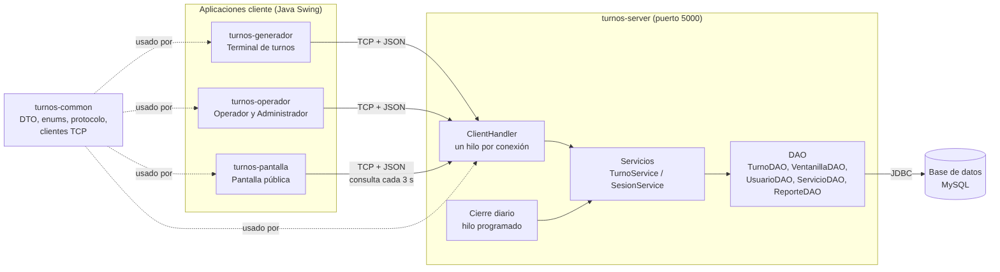
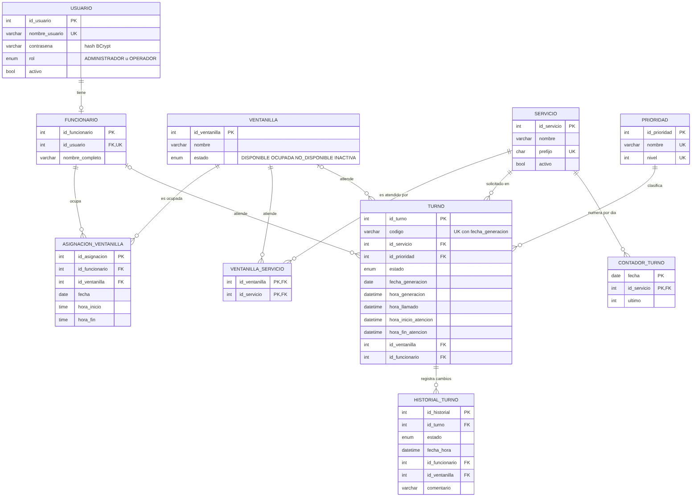

# Documento técnico — Sistema Distribuido de Gestión de Turnos

**Universidad Nacional — Ingeniería en Sistemas de Información**
**EIF206 Programación III — Proyecto grupal (45 %)**

| | |
|---|---|
| **Proyecto** | Sistema Distribuido de Gestión de Turnos |
| **Grupo** | [COMPLETAR: número de grupo] |
| **Profesor** | [COMPLETAR] |
| **Fecha de entrega** | [COMPLETAR] |
| **Repositorio** | `jorgefernandez667/progra3` (GitHub) |

## 1. Integrantes

| Nombre | Carné | Correo |
|---|---|---|
| [COMPLETAR] | [COMPLETAR] | [COMPLETAR] |
| [COMPLETAR] | [COMPLETAR] | [COMPLETAR] |
| [COMPLETAR] | [COMPLETAR] | [COMPLETAR] |

## 2. Descripción del problema

Una institución ofrece varios servicios de atención al público (información general, trámites, pagos y atención preferencial). Las personas llegan, eligen el servicio que necesitan y reciben un turno (por ejemplo `B014`). Varios funcionarios, ubicados en distintas ventanillas, piden el siguiente turno desde su propia aplicación, y una pantalla en la sala de espera muestra cuál turno fue llamado y a qué ventanilla debe dirigirse.

El reto principal es que **varias aplicaciones trabajen a la vez sobre los mismos datos sin generar inconsistencias**: un turno no puede entregarse a dos ventanillas, una ventanilla no puede atender dos turnos a la vez, y dos terminales que generan turnos al mismo tiempo no pueden recibir el mismo número. Además, el sistema debe conservar la información de cada atención para poder consultarla después (reportes).

## 3. Descripción general de la solución

Se desarrolló un sistema cliente-servidor en Java con cuatro aplicaciones:

| Aplicación | Módulo | Función |
|---|---|---|
| Servidor central | `turnos-server` | Recibe las solicitudes de todos los clientes, aplica las reglas del negocio y es el único que habla con la base de datos. |
| Generador de turnos | `turnos-generador` | Terminal de la sala de entrada: pide al servidor los servicios activos, la persona elige uno (y su prioridad) y recibe su código de turno. |
| Operador / Administrador | `turnos-operador` | Inicio de sesión. El operador llama, reclama, inicia y finaliza turnos y puede marcar su ventanilla como no disponible. El administrador gestiona ventanillas, servicios, usuarios y consulta los reportes. |
| Pantalla pública | `turnos-pantalla` | Muestra el último turno llamado, la ventanilla a la que debe dirigirse, los llamados recientes y la hora actual, y emite un sonido en cada llamado. |

Las aplicaciones **no acceden a la base de datos**: se comunican únicamente con el servidor mediante sockets TCP. El módulo `turnos-common` contiene lo que comparten todas (DTO, enumeraciones, protocolo de mensajes y clientes TCP).

### Funcionalidades principales

- Generación de turnos con código por servicio y reinicio diario (`A001`, `A002`…), con registro de fecha y hora.
- Cola con prioridades: **URGENTE > PREFERENCIAL > NORMAL**; dentro de una misma prioridad, el más antiguo primero (hora de generación y, si empatan, el identificador).
- Operador: iniciar sesión (se le asigna una ventanilla), llamar siguiente, volver a llamar, iniciar y finalizar atención, marcar la ventanilla como no disponible.
- Pantalla pública con actualización automática, llamados recientes, reloj y sonido.
- Administración: usuarios (crear operadores, activar/desactivar, restablecer contraseña, cambiar nombre), ventanillas (activar/desactivar), tipos de servicio (crear, renombrar, activar/desactivar) y **qué servicios atiende cada ventanilla**.
- Cinco reportes: turnos atendidos entre fechas, atención por funcionario, atención por servicio, tiempo de espera y tiempo de atención.
- Ocho estados de turno con historial de cada cambio.

### Innovación

- **Sonido de llamado** en la pantalla pública (dos notas sintetizadas, en un hilo aparte), tanto al llamar como al volver a llamar.
- **Cierre diario automático**: los turnos que quedaron en espera de días anteriores pasan a `CANCELADO` (como en un hospital o banco, donde el turno solo vale el día en que se emite).
- **Liberación automática**: si un operador cierra sesión o pierde la conexión, el turno que tenía llamado vuelve a la cola y el que estaba en atención queda `ABANDONADO`.
- **Servicios por ventanilla** y **estado "no disponible"** temporal controlado por el propio operador.

## 4. Arquitectura utilizada

### 4.1 Arquitectura por capas

```
Presentación      Interfaces Swing (generador, operador/administrador, pantalla)
      │  TCP + JSON (turnos-common: Request / Response / DTO)
      ▼
Red               ClientHandler  — lee solicitudes, valida la sesión y el rol, responde
      ▼
Aplicación        TurnoService, SesionService — reglas del negocio
      ▼
Acceso a datos    TurnoDAO, VentanillaDAO, UsuarioDAO, ServicioDAO, ReporteDAO — SQL / JDBC
      ▼
Base de datos     MySQL
```

- Las interfaces **no contienen SQL ni lógica del negocio**: solo arman un `Request`, lo envían y muestran la `Response`.
- El SQL vive únicamente en los DAO. El servidor es el único con acceso a la base de datos.
- Las entidades (`Turno`, `Servicio`, `Ventanilla`, `Usuario`, `Funcionario`…) están en `turnos-common/domain`; los objetos que viajan por la red son DTO (`TurnoDTO`, `VentanillaDTO`, `ServicioDTO`, `UsuarioDTO`).

### 4.2 Estructura de módulos Maven

```
SistemaTurnos
├── turnos-common     enums, domain, dto, protocol, network (clientes TCP), util, exception
├── turnos-server     ServerApplication, network, service, dao, config, security, init
├── turnos-generador  GeneradorTurnosFrame
├── turnos-operador   LoginFrame, OperadorTurnosFrame, AdminFrame
├── turnos-pantalla   PantallaTurnosFrame, SonidoLlamado
└── sql               crear_base_datos.sql, datos_prueba.sql, migraciones 002–006
```

### 4.3 Diagrama general de componentes



## 5. Diseño de la base de datos

### 5.1 Diagrama entidad-relación



### 5.2 Tablas

| Tabla | Propósito |
|---|---|
| `usuario` | Credenciales (hash BCrypt), rol (`ADMINISTRADOR`/`OPERADOR`) y si está activo. |
| `funcionario` | Persona que atiende; 1 a 1 con un usuario operador. |
| `ventanilla` | Puestos de atención y su estado (`DISPONIBLE`, `OCUPADA`, `NO_DISPONIBLE`, `INACTIVA`). |
| `servicio` | Tipos de servicio con su prefijo (A, B, C, D) y si están activos. |
| `prioridad` | Catálogo de prioridades (`NORMAL`, `PREFERENCIAL`, `URGENTE`). |
| `ventanilla_servicio` | Relación N:M: qué servicios atiende cada ventanilla (sin filas = atiende todos). |
| `asignacion_ventanilla` | Bitácora de quién ocupó qué ventanilla, en qué fecha y entre qué horas. |
| `turno` | El turno, con servicio, prioridad, estado y los tiempos de generación, llamado, inicio y fin de atención, más la ventanilla y el funcionario que lo atendieron. |
| `historial_turno` | Una fila por cada cambio de estado de un turno (trazabilidad). |
| `contador_turno` | Último número usado por día y servicio; sirve para generar códigos únicos sin colisiones. |

### 5.3 Decisiones de diseño

- **Normalización:** los catálogos (`servicio`, `prioridad`) están separados de `turno`; la relación ventanilla–servicio es una tabla intermedia; el nombre del servicio o de la ventanilla no se repite en cada turno.
- **Código del turno único por día**, no global: restricción `UNIQUE (fecha_generacion, codigo)`, porque la numeración reinicia cada día.
- **Desactivar en lugar de borrar** (`activo`, `INACTIVA`): los turnos históricos siguen apuntando al servicio, ventanilla o funcionario que los atendió, y los reportes no se rompen.
- **Contraseñas con BCrypt** (costo 12); nunca se almacenan en claro.
- **Todas las relaciones tienen llave foránea** y los campos de consulta frecuente tienen índice (`estado`, `fecha_generacion`, `id_servicio`, `(id_turno, fecha_hora)`).
- El proyecto usa **MySQL**, con autorización del profesor (el enunciado menciona Oracle). El esquema usa solo SQL estándar salvo `ENUM`, `AUTO_INCREMENT` e `INSERT … ON DUPLICATE KEY`, por lo que la migración a otro motor requeriría cambios puntuales en esos puntos.

### 5.4 Scripts

| Archivo | Uso |
|---|---|
| `SistemaTurnos/sql/crear_base_datos.sql` | Crea todo el esquema final (borra y recrea las tablas). |
| `SistemaTurnos/sql/datos_prueba.sql` | Catálogos, ventanillas, usuarios y 36 turnos históricos (con su historial) de cuatro días, para que los reportes tengan datos. |
| `SistemaTurnos/sql/002…006_*.sql` | Migraciones para actualizar una base creada con el esquema anterior; ya están incluidas en `crear_base_datos.sql`. |

Usuarios de prueba: `admin` / `Admin123*` (administrador) y `operador1`, `operador2`, `operador3` / `Turnos123*` (operadores).

## 6. Estados de un turno

| Estado | Significado | ¿Cuándo ocurre? |
|---|---|---|
| `EN_ESPERA` | Generado, aguardando ser llamado | Al generar el turno |
| `LLAMADO` | Una ventanilla lo llamó | Al pedir el siguiente (o volver a llamar) |
| `EN_ATENCION` | La persona fue atendida | Al iniciar la atención |
| `FINALIZADO` | Atención terminada | Al finalizar |
| `CANCELADO` | Nunca fue atendido | Cierre diario: turnos en espera de días anteriores |
| `ABANDONADO` | Se perdió la atención en curso | El operador cierra sesión o se desconecta con el turno en atención |
| `TRANSFERIDO`, `SUSPENDIDO` | Reservados en el modelo | Definidos en el esquema; todavía no tienen una operación en la interfaz |

Los estados adicionales a los cuatro mínimos se justifican así: `CANCELADO` y `ABANDONADO` hacen visible en los reportes qué turnos no se atendieron y por qué, en lugar de dejarlos "en espera" para siempre.

## 7. Comunicación entre aplicaciones

### 7.1 Mecanismo: sockets TCP

El servidor escucha en el puerto **5000** (`ServerApplication`, `ServerSocket`). Cada cliente se conecta por TCP y se intercambian **mensajes JSON de una línea** (un mensaje por línea, codificación UTF-8), serializados con Jackson.

```
Request  { idSolicitud, tipo, datos }
Response { idSolicitud, tipo, exitoso, mensaje, datos }
```

`tipo` es un valor del enum `TipoMensaje` (`LOGIN`, `GENERAR_TURNO`, `SOLICITAR_SIGUIENTE_TURNO`, `INICIAR_ATENCION`, `FINALIZAR_ATENCION`, `RECLAMAR_TURNO`, `CAMBIAR_DISPONIBILIDAD`, `ACTUALIZAR_PANTALLA`, `OBTENER_REPORTES`, etc.). El servidor responde siempre con una `Response`; los errores viajan con `exitoso = false` y un mensaje comprensible.

### 7.2 Tipos de conexión

- **Operador y administrador** (`TcpSessionClient`): una conexión **persistente** durante toda la sesión; el servidor mantiene el estado de esa sesión (quién es, qué ventanilla ocupa).
- **Generador y pantalla pública** (`TcpClient`): una conexión corta por solicitud, sin sesión.

### 7.3 Actualización de la pantalla pública

La pantalla pregunta al servidor por el último turno llamado **cada 3 segundos** (`ACTUALIZAR_PANTALLA`), de forma automática y sin que nadie presione un botón. Es una consulta periódica (*polling*) al servidor, no a la base de datos.

### 7.4 Recorrido de una operación (llamar siguiente turno)

1. El operador presiona **Llamar siguiente** en `OperadorTurnosFrame`.
2. `TcpSessionClient` envía `Request(SOLICITAR_SIGUIENTE_TURNO)` al servidor.
3. `ClientHandler` (el hilo de esa conexión) verifica la sesión y llama a `TurnoService.llamarSiguienteTurno`.
4. `TurnoService` cancela los turnos de días anteriores y delega en `TurnoDAO.llamarSiguienteTurno`.
5. `TurnoDAO` abre una transacción, bloquea la ventanilla, elige el turno, lo marca `LLAMADO`, escribe el historial y confirma.
6. La `Response` con el turno vuelve al operador, que lo muestra.
7. En el siguiente ciclo, la pantalla pública consulta y muestra `Turno → Ventanilla` con sonido.

## 8. Uso de hilos

| Dónde | Hilo | Por qué es necesario |
|---|---|---|
| `ServerApplication` | Hilo principal: `accept()` en bucle. Cada conexión se entrega a un `ExecutorService` de **50 hilos** (`ServerConfig.MAX_CLIENTES`) que ejecuta un `ClientHandler` (`Runnable`). | El servidor debe atender a varios clientes a la vez; un cliente lento o bloqueado no impide que los demás sigan trabajando. |
| `ServerApplication.iniciarCierreDiario` | Hilo programado `cierre-diario` (`ScheduledExecutorService`, *daemon*). | Cancela los turnos viejos al arrancar y cada medianoche, sin depender de que alguien use el sistema. |
| `PantallaTurnosFrame` | `javax.swing.Timer` cada 3 s que lanza un `SwingWorker`. | La consulta al servidor se hace fuera del hilo de la interfaz para que la pantalla no se congele si el servidor tarda. |
| `SonidoLlamado` | Hilo `sonido-llamado` (un solo hilo, *daemon*). | Reproducir audio bloquea; en un hilo aparte la pantalla sigue respondiendo y los sonidos no se encimen. |

**Recursos compartidos entre hilos:** la base de datos (turnos, ventanillas, contadores) y el servidor mismo. Cada `ClientHandler` tiene sus **propias** instancias de `TurnoService` y `SesionService`, por lo que el estado de sesión no se comparte entre clientes y no necesita sincronización.

## 9. Control de concurrencia

### 9.1 Idea central

Como cada cliente tiene su propia instancia de los servicios, **los métodos `synchronized` de Java solo protegen dentro de una misma conexión; no impiden que dos ventanillas compitan entre sí**. La garantía real entre clientes está en la **base de datos**: transacciones con bloqueos de fila (`SELECT … FOR UPDATE`) y actualizaciones condicionadas al estado.

### 9.2 Llamar el siguiente turno (dos ventanillas a la vez)

En `TurnoDAO.llamarSiguienteTurno`, todo ocurre en **una transacción**:

1. `SELECT estado FROM ventanilla WHERE id_ventanilla = ? FOR UPDATE` — bloquea la fila de **la propia ventanilla**. Sirve para comprobar que está `OCUPADA` (no pausada ni inactiva) y para que una misma ventanilla no pueda llamar dos turnos a la vez.
2. Se verifica que la ventanilla no tenga ya un turno `LLAMADO` o `EN_ATENCION`.
3. `SELECT … FROM turno WHERE estado = 'EN_ESPERA' [servicios de la ventanilla] ORDER BY prioridad, hora_generacion, id_turno LIMIT 1 FOR UPDATE` — bloquea la fila del candidato. Si otra ventanilla ya lo tiene bloqueado, **espera a que esa transacción termine**; cuando termina, el turno ya no está `EN_ESPERA` y la consulta devuelve el siguiente. Si no hay más, devuelve "no hay turnos pendientes".
4. `UPDATE turno SET estado = 'LLAMADO' … WHERE id_turno = ? AND estado = 'EN_ESPERA'` — doble protección: solo cambia si todavía estaba en espera.
5. Se inserta el historial y se confirma (`COMMIT`).

Resultado: **nunca** dos ventanillas obtienen el mismo turno; la perdedora recibe otro o un mensaje claro.

### 9.3 Resto de garantías exigidas

| Regla del enunciado | Mecanismo |
|---|---|
| Turnos únicos | `contador_turno`: `INSERT … ON DUPLICATE KEY UPDATE ultimo = ultimo + 1` en la misma transacción que inserta el turno; MySQL bloquea la fila del contador, así dos generadores nunca reciben el mismo número. Respaldo: `UNIQUE (fecha_generacion, codigo)`. |
| Un turno no lo atienden dos ventanillas | Bloqueo de la fila del turno (9.2) y `UPDATE … WHERE estado = ?`. |
| Una ventanilla no atiende dos turnos a la vez | Bloqueo de la fila de la ventanilla y verificación de turno en curso. |
| Un turno finalizado no vuelve a asignarse | Las transiciones de estado se hacen con `UPDATE … WHERE estado = <estado esperado>` (`cambiarEstadoConHistorial`); un turno `FINALIZADO` no es candidato porque solo se llaman los `EN_ESPERA`. |
| Pausar la ventanilla mientras se llama un turno | Ambas operaciones bloquean la misma fila de la ventanilla, por lo que se ejecutan en serie. |
| Configurar servicios mientras se llama | `asignarServicios` bloquea también la fila de la ventanilla. |

### 9.4 Prueba realizada

Con MariaDB y el servidor real se ejecutaron pruebas de estrés automatizadas durante el desarrollo: cientos de llamados simultáneos de dos ventanillas y cientos de cambios de disponibilidad, con **cero** violaciones de las reglas anteriores (ningún turno llamado dos veces, ninguna ventanilla con dos turnos); y 200 turnos de dos servicios repartidos entre dos ventanillas con servicios distintos configurados, sin duplicados y sin que una ventanilla tomara un servicio que no le correspondía.

## 10. Patrones de diseño

| Patrón | Problema que resuelve | Dónde se aplica | Beneficio |
|---|---|---|---|
| **DAO** (Data Access Object) | Mezclar SQL con la lógica del negocio y las pantallas hace el código difícil de mantener y de probar. | `TurnoDAO`, `VentanillaDAO`, `UsuarioDAO`, `ServicioDAO`, `ReporteDAO` en `turnos-server/dao`. Solo ellos escriben SQL y manejan conexiones JDBC. | Los servicios trabajan con objetos Java; cambiar una consulta o el motor afecta únicamente a los DAO. |
| **DTO** (Data Transfer Object) | Enviar por la red las entidades completas expone datos que el cliente no necesita (por ejemplo, el hash de la contraseña) y acopla el cliente al modelo interno. | `TurnoDTO`, `VentanillaDTO`, `ServicioDTO`, `UsuarioDTO` en `turnos-common/dto`. | Los clientes solo reciben lo que necesitan, y el formato del mensaje queda desacoplado de las entidades. |
| **Capa de servicios / Fachada** | Los clientes y el manejador de red no deben conocer los detalles de cómo se coordinan varios DAO ni las reglas del negocio. | `TurnoService` y `SesionService`: por ejemplo, `llamarSiguienteTurno` cancela turnos viejos y luego delega en el DAO; `cerrarSesion` libera turnos y la ventanilla. | `ClientHandler` queda limitado a la red y la validación; las reglas están en un solo lugar. |

> **Nota sobre otros patrones:** el enunciado menciona también *Observer*. En esta versión la pantalla pública se actualiza consultando periódicamente al servidor (sección 7.3); el servidor no "empuja" los cambios, por lo que no se aplica Observer. Sería una mejora natural (ver sección 13).

## 11. Seguridad, validaciones y manejo de errores

- **Autenticación:** las operaciones del operador y del administrador exigen iniciar sesión; el servidor verifica la sesión en cada solicitud.
- **Perfiles:** `ADMINISTRADOR` (gestión del sistema y reportes) y `OPERADOR` (atención de turnos). Cada operación administrativa valida el rol en el servidor, no solo ocultando botones; un administrador desactivado con la sesión abierta deja de poder operar.
- **Contraseñas:** BCrypt, mínimo 8 caracteres.
- **Reglas de protección:** no se desactiva a un operador con la sesión abierta, un administrador no puede desactivarse a sí mismo, siempre queda al menos un administrador y al menos un servicio activo.
- **Validaciones:** campos obligatorios, formatos (prefijo de una sola letra, longitudes de nombres, tipos de los datos del mensaje), servicios y ventanillas inexistentes, operaciones no permitidas en el estado actual (por ejemplo, iniciar la atención de un turno que no está llamado).
- **Errores comprensibles:** los errores de negocio viajan como mensaje en la `Response` ("No hay turnos pendientes para esta ventanilla.", "Debe quedar al menos un servicio activo.", etc.); los errores técnicos de base de datos se muestran de forma genérica sin exponer detalles internos.
- **Casos cubiertos:** sin turnos pendientes, ventanilla no disponible o inactiva, solicitudes simultáneas y desconexión del cliente (el servidor libera la ventanilla y los turnos en curso).

## 12. Instrucciones para ejecutar el sistema

### 12.1 Requisitos

- JDK 21 o superior (el `pom.xml` del proyecto compila con `maven.compiler.release` 26: use el JDK que tenga configurado NetBeans o ajuste ese valor a 21).
- Maven 3.9 o superior, NetBeans, y MySQL 8.x.

### 12.2 Base de datos

1. Cree una base de datos vacía (en el proyecto se llama `gamabasis_p3g3`) con juego de caracteres `utf8mb4`.
2. Ejecute, en este orden, `SistemaTurnos/sql/crear_base_datos.sql` y `SistemaTurnos/sql/datos_prueba.sql`.
3. Defina las variables de entorno con las credenciales de la base de datos:
   - `TURNOS_DB_USER`
   - `TURNOS_DB_PASSWORD`
4. La URL de conexión está en `turnos-server/.../config/DatabaseConfig.java`. Si usa una base local, cambie el servidor de la URL (`jdbc:mysql://localhost:3306/gamabasis_p3g3?serverTimezone=America/Costa_Rica`).

### 12.3 Compilar

Desde la carpeta `SistemaTurnos`:

```bash
mvn clean install -DskipTests
```

En NetBeans: clic derecho en el proyecto padre `SistemaTurnos` → **Clean and Build** (hágalo sobre el padre, no solo sobre un módulo, para que `turnos-common` se actualice).

### 12.4 Ejecutar (en este orden)

| # | Aplicación | Clase principal |
|---|---|---|
| 1 | Servidor | `cr.ac.una.turnos.server.ServerApplication` |
| 2 | Pantalla pública | `cr.ac.una.turnos.pantalla.PantallaTurnosFrame` |
| 3 | Operadores (ejecutar **dos veces** para dos operadores) y administrador | `cr.ac.una.turnos.operador.OperadorTurnosFrame` (abre el inicio de sesión) |
| 4 | Generador de turnos | `cr.ac.una.turnos.generador.GeneradorTurnosFrame` |

Para que los clientes se conecten a un servidor en otro equipo: `-Dturnos.server.host=<IP>` o la variable `TURNOS_SERVER_HOST` (puerto 5000 por defecto, configurable con `turnos.server.port` / `TURNOS_SERVER_PORT`).

### 12.5 Escenario de demostración

1. Inicie el servidor y la pantalla pública.
2. Abra dos aplicaciones de operador: `operador1` y `operador2` (clave `Turnos123*`); cada una recibe una ventanilla distinta.
3. En el generador, cree varios turnos de distintos servicios (A001, A002, B001, A003, C001…).
4. `operador1` presiona **Llamar siguiente**: la pantalla muestra el turno y la ventanilla, con sonido.
5. `operador2` llama otro turno; ambos trabajan a la vez.
6. Pruebe **Volver a llamar**, **Iniciar atención**, **Finalizar atención** y **Marcar ventanilla como no disponible**.
7. Entre como `admin` (`Admin123*`) y revise ventanillas, servicios, usuarios y los cinco reportes: los datos quedaron en la base.

### 12.6 Prueba de concurrencia

Genere unos 20 turnos, abra dos operadores y presione **Llamar siguiente** en ambos lo más rápido posible, varias veces: nunca deben recibir el mismo código. Pruebe también cerrar un operador con un turno llamado (el turno vuelve a la cola) y reiniciar una aplicación cliente.

## 13. Limitaciones conocidas y mejoras futuras

- La pantalla pública usa consulta periódica cada 3 s; una mejora sería que el servidor notifique los llamados (patrón Observer) por conexiones persistentes.
- Los estados `TRANSFERIDO` y `SUSPENDIDO` están en el modelo, pero aún no hay una operación en la interfaz que los use.
- No hay pruebas unitarias automatizadas dentro del proyecto Maven; las pruebas de concurrencia se hicieron con programas auxiliares fuera del repositorio.
- Hay clases de prueba de la etapa de laboratorio en el servidor (`PruebaTurno`, `PruebaTurnoDAO`, `PruebaConexionBD`) y la tabla `turno_lab` en la base original, que no forman parte de la solución.

## 14. Distribución del trabajo

| Integrante | Responsabilidades |
|---|---|
| [COMPLETAR] | [COMPLETAR] |
| [COMPLETAR] | [COMPLETAR] |
| [COMPLETAR] | [COMPLETAR] |

## 15. Conclusiones

[COMPLETAR por el grupo. Sugerencias de qué mencionar: lo aprendido sobre sockets y concurrencia con bloqueos de base de datos, por qué `synchronized` no alcanza entre clientes distintos, las dificultades encontradas y lo que mejorarían.]
